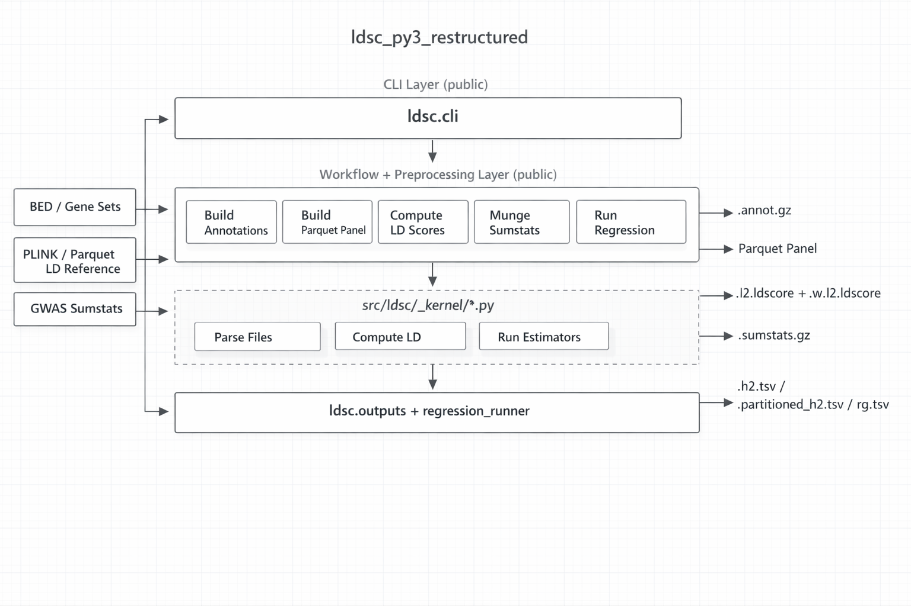

# Architecture 

Last updated on: 2026-10-20

`ldsc` is the refactored Python 3 LDSC package. It reads optional SNP-level annotations, PLINK or parquet R2 references, and GWAS summary statistics; resolves user-facing path and header conventions in the public workflow layer; delegates numerical work to `ldsc._kernel`; and writes LDSC-compatible artifacts that can be chained into later runs.

Start with [the contributor entry](code-structure.md) to locate a change; this document explains the execution architecture. Related domain references:

- [parallel-execution.md](parallel-execution.md): worker budgets, one BLAS thread per worker, process ownership, and chromosome logs
- [data-flow.md](data-flow.md): user-visible file streams and flowcharts
- [class-and-features.md](class-and-features.md): public API surface and major types
- [code-structure.md](code-structure.md): module map and change guide
- [workflow-logging.md](workflow-logging.md): per-run log naming, preflight, and API boundaries
- [plotting-module.md](plotting-module.md): plotting, post-fit h2 conversion, dispatch, and derived-output ownership
- [gene-list-input-format.md](gene-list-input-format.md): gene-list parsing, catalog, projection, and diagnostics
- [ref-panel-r2-query.md](ref-panel-r2-query.md): pairwise R2 lookup contract for package-built panels
- [liftover-harmonization-decisions.md](liftover-harmonization-decisions.md): current liftover contracts and follow-up handoff prompt
- [partitioned-h2-results.md](partitioned-h2-results.md): partitioned-h2 result columns and interpretation
- [continuous-annotation-quantile-h2.md](continuous-annotation-quantile-h2.md): continuous-annotation post-fit contracts
- [layer-structure.md](layer-structure.md): layer-by-function object matrix
- [annotation-memory-design.md](annotation-memory-design.md): consolidated memory and CPU efficiency designs, including bit-packing, genotype/R² streaming, sparse projection, index reuse, workers, regression copies/artifacts, exact quantiles, and evidence limits



## Bird's-Eye View

- **Build query annotations**: project BED or resolved gene intervals onto a SNP grid; standalone `annotate` accepts mutually exclusive BIM or baseline-annotation sources. Entry points: `ldsc annotate`, `ldsc ldscore`, `ldsc.AnnotationBuilder`
- **Build parquet reference panels**: convert PLINK genotype panels into standard parquet R2 artifacts. Entry points: `ldsc build-r2-panel`, `ldsc.ReferencePanelBuilder`
- **Query reference-panel R2**: look up adjusted R2, `sign_r`, and signed Pearson `r` for SNP pairs in package-built index-format panels. Entry points: `ldsc query-r2`, `ldsc.R2Panel`, `ldsc.query_r2()`
- **Build exact gene LD-score indexes**: precompute PLINK-backed disjoint-atom operators for one complete immutable baseline/reference/gene configuration. Entry point: `ldsc build-gene-ldscore-index`
- **Compute LD scores**: align annotations to a live reference panel or explicitly assemble gene-list columns from a validated complete index, then emit the same canonical artifacts. Entry points: `ldsc ldscore`, `ldsc.run_ldscore()`, `ldsc.LDScoreCalculator`
- **Munge raw summary statistics**: normalize raw GWAS tables into curated Parquet-first sumstats artifacts, with optional legacy `.sumstats.gz` output. Entry points: `ldsc munge-sumstats`, `ldsc.SumstatsMunger`
- **Run LDSC regression**: consume munged sumstats and LD-score artifacts to estimate `h2`, partitioned `h2`, or `rg`. Entry points: `ldsc h2`, `ldsc partitioned-h2`, `ldsc rg`, `ldsc.RegressionRunner`
- **Explore canonical results**: dispatch one approved figure from h2, partitioned-h2, quantile-h2, or rg result metadata without refitting. Entry points: `ldsc plot`, `ldsc.plot_result()`
- **Convert saved h2 scale**: convert observed-scale h2 at one population prevalence or over a sensitivity grid. Entry points: `ldsc convert-h2-scale`, `ldsc.convert_h2_scale()`
- **Project continuous-target quantiles**: verify one fitted partitioned model and resupplied SNP annotations, then calculate joint-model quantile heritability and standardized coefficients without refitting. Entry point: `ldsc quantile-h2`
- **Audit workflow runs**: artifact-writing workflow wrappers create deterministic
  per-run logs around their owned work. The gene-index builder writes its log
  to hidden `.<index-name>.build-state/` before destination preflight/recovery
  so failures do not create a partial index, then moves a closed successful log
  into the published `diagnostics/`. Logs are audit artifacts and are not
  included in result `output_paths`.

## Layer Structure

- **CLI Layer**: public command dispatch in `ldsc.cli`
- **Workflow And Preprocessing Layer**: public services in `ldsc.annotation_builder`, `ldsc.ref_panel_builder`, `ldsc.r2_query`, `ldsc.ldscore_calculator`, `ldsc.sumstats_munger`, `ldsc.regression_runner`, and `ldsc.quantile_h2`, plus shared normalization in `ldsc.config`, `ldsc.path_resolution`, `ldsc.column_inference`, `ldsc.chromosome_inference`, `ldsc.genome_build_inference`, `ldsc.annotation_semantics`, and the internal `ldsc.gene_list_resolver`
- **Compute Kernel**: private file-format and numerical code in `ldsc._kernel.*`
- **Shared Artifact Access**: canonical LD-score directory opening, schema/identity validation, and selected-query reads in `ldsc.ldscore_source`, consumed by generation and regression
- **Output And Derived-Result Layer**: canonical LD-score, h2, partitioned-h2, quantile-h2, and rg artifact writing
  in `ldsc.outputs`, plus the fixed h2 summary writer in
  `ldsc.regression_runner`; metadata-driven plotting in
  `ldsc.plotting`; post-fit scale conversion in `ldsc.h2_scale`

## File Tree

```text
ldsc_py3_restructured/
├── docs/
│   ├── current/
│   │   ├── architecture.md      # package-level architecture
│   │   ├── class-and-features.md
│   │   ├── code-structure.md
│   │   └── data-flow.md         # workflow-level file streams
│   └── assets/
├── src/ldsc/
│   ├── __init__.py          # public Python exports
│   ├── __main__.py          # `python -m ldsc` entry point
│   ├── cli.py               # unified `ldsc` command
│   ├── config.py            # validated public config dataclasses
│   ├── _logging.py          # workflow log context and LDSC logger control
│   ├── path_resolution.py   # input-token normalization and discovery
│   ├── column_inference.py  # header and identifier normalization
│   ├── chromosome_inference.py
│   ├── genome_build_inference.py
│   ├── gene_list_resolver.py
│   ├── gene_ldscore_index.py
│   ├── query_annotations.py
│   ├── annotation_builder.py
│   ├── _annotation_queries.py    # bounded BED/gene query preparation
│   ├── _annotation_projection.py # interval membership on chromosome SNP grids
│   ├── ref_panel_builder.py
│   ├── r2_query.py
│   ├── ldscore_calculator.py
│   ├── ldscore_source.py     # directory loading, validation, and selected reads
│   ├── sumstats_munger.py
│   ├── _sumstats_input.py   # resolved raw schema and source-build preparation
│   ├── regression_runner.py
│   ├── h2_scale.py        # post-fit observed-to-liability conversion
│   ├── plotting/          # metadata dispatcher and private Matplotlib builders
│   ├── overlap_matrix.py    # overlap container, serde, assembly, overlap-aware summary
│   ├── outputs.py           # LD-score and partitioned-h2 artifact writers
│   └── _kernel/
│       ├── overlap.py       # low-level annotation overlap-block computation
│       ├── annotation.py    # concrete annotation table reading and validation
│       ├── ref_panel_builder.py
│       ├── ref_panel.py
│       ├── r2_query.py
│       ├── ldscore.py
│       ├── gene_ldscore_index.py
│       ├── sumstats_munger.py
│       ├── snp_identity.py # shared SNP identity and restriction policy
│       ├── liftover.py
│       ├── regions.py
│       ├── regression.py
│       ├── _jackknife.py
│       ├── _irwls.py
│       ├── formats.py
│       └── identifiers.py
├── tests/                   # workflow and parity checks
└── tutorials/               # end-to-end usage examples
```

## Code Map

### `ldsc.cli`

This is the only command-line entry point. It parses subcommands, preserves the user-facing CLI contract, and hands control to the public workflow modules. Architecture invariant: CLI code should dispatch only; it should not contain numerical logic.

### `ldsc.config`, `ldsc.path_resolution`, `ldsc.column_inference`, `ldsc.chromosome_inference`, `ldsc.genome_build_inference`

These modules define the package-wide contracts that every workflow shares.
They normalize path tokens, chromosome ordering, genome-build aliases, exact SNP identifier modes, input header aliases, and `chr_pos`-family genome-build inference before the kernel is called.
`ldsc.path_resolution` also owns output-directory creation, fixed-artifact collision preflight, coherent artifact-family preflight, and stale owned-sibling cleanup helpers.
`ldsc.genome_build_inference` is public for Python callers through the top-level `ldsc` exports, while the CLI exposes it through the existing `--genome-build auto` or `--source-genome-build auto` option for each workflow.
Architecture invariant: numerical functions consume resolved inputs.
Shared normalization stays here or in the workflow layer; the runtime reference-panel adapters currently live at `ldsc._kernel.ref_panel` and resolve panel-specific inputs before numerical projection.

### `ldsc._genome_build_policy`

`GenomeBuildCheck` collects declared, inferred, unresolved, and unchecked evidence before resolving a workflow coordinate build.
It uses shared path expansion and column aliases, trusts concrete artifact declarations, and bounds coordinate inference per file/chromosome.
All evidence is collected before conflict/unresolved errors; concrete user builds bypass inference and comparison within the option's scope.
Workflows and reference adapters call this helper before filtering or numerical work; numerical readers receive a concrete build and do not repeat the decision.
Restriction column selection in `column_inference.py` prefers the matching named position column, then generic `POS`.
`genome_build_inference.py` retains the HM3 confidence and coordinate-basis calculations.
See the [build policy](snp-identifier-genome-build-defaults.md#genome-build-policy) for command scope, BED inheritance, source/output separation, and grouped diagnostics.

### `ldsc._logging`

This module owns the small shared logging context used by workflow wrappers.
It sets the LDSC logger threshold, attaches a per-run file handler to the
`LDSC` ancestor logger, writes lifecycle audit lines, captures a run-aborting
traceback into the log file on failure, restores logger state on exit, and
exposes log-only formatting helpers. It also owns the CLI console-handler
lifecycle: the per-run `.log` file is the authoritative sink, while the console
(stderr) is CLI-only and silent except for errors (it falls back to full
verbosity only for low-level calls without a workflow log). The Python API never
emits console output. Architecture invariant: workflows preflight the
log path with scientific outputs before entering the context, and result
`output_paths` mappings do not include logs.

The same module owns the small `RUN_FAILED` marker helper used at public
materializing boundaries. The helper adds failure visibility for authorized
overwrites but performs no rollback, restoration, quarantine, or action-order
change. See [workflow-logging.md](workflow-logging.md).

### `ldsc.plotting`, `ldsc.h2_scale`

`ldsc.plotting.plot_result()` is the sole public plot dispatcher. It selects
one approved plot from canonical `diagnostics/metadata.json`, follows declared
source paths, and imports private Matplotlib builders only on a plot-producing
path. `ldsc.h2_scale.convert_h2_scale()` reads the observed estimate and SE
from a canonical h2 result and reuses the kernel liability conversion factor;
only prevalence-range mode imports Matplotlib. Both default to package-owned
nested result roots and allow an advanced Python-only destination override.
Their complete seams are documented in [plotting-module.md](plotting-module.md).

For rg, the dispatcher loads the correlation table and optional metadata-declared single-trait h2 table. Private builders align observed h2 and SE by trait name for the heatmap diagonal or anchor annotations. Missing h2 values display `failed`; the plotting layer neither reruns regression nor chooses among pair-specific heritability fits. See [the annotation contract](plotting-module.md#heritability-annotations-in-rg-plots).

### `ldsc.annotation_builder`

This is the public annotation API and CLI dispatch seam: `AnnotationBuilder`, `AnnotationBundle`, `run_annotate()`, `parse_annotate_args()`, `run_annotate_from_args()`, and `main()`.
`AnnotationBuilder.run(..., output_dir=...)` prepares a chromosome-backed dataset with explicit ownership.
`annotate_workflow` owns standalone BED/gene validation and incremental canonical output.
`_annotation_bim` stages metadata-only BIM grids through shared identity selection.
Annotation-grid input emits aligned baseline/query families; BIM input emits query values only.
`_annotation_outputs` reopens these exports without original-input dependencies.
Shared `_annotation_*` modules own bounded discovery, identity cleanup, separate metadata/value artifacts, projection, and storage lifetime; `_direct_annotation` integrates them with direct LD-score scope and support gates.
The complete module and ownership map is in [annotation-memory-design.md](annotation-memory-design.md).

For interval projection, `_annotation_queries.prepare_bed_queries()` streams validated BED rows from `_kernel.regions.iter_bed_rows()` into chromosome spools.
`_annotation_queries.build_query_shards()` uses `_annotation_projection.ChromosomeProjector` for both BED and gene intervals, preserving zero-based half-open membership against one-based SNP positions.

### `ldsc.gene_list_resolver`, `ldsc.query_annotations`

These internal helpers validate the user-supplied or index-embedded catalog, resolve exact identifiers, and apply ordered query-status rules. `_gene_query_storage` shares catalog lookups, stages per-source selections and complete audits, and returns compact summaries. Catalog-build selection, scientific-query pruning, and final diagnostic publication remain with the consuming workflow.

### `ldsc.ref_panel_builder`

This module builds standard parquet R2 reference artifacts from PLINK inputs. It handles optional genetic-map loading, optional chain-file liftover selection, explicit SNP restriction filtering, liftover-stage drop audit sidecars, output-path construction, and build logs under `diagnostics/`, then delegates pairwise-R2 emission to the kernel. PLINK source build is explicit or inferred locally; a matching chain emits the opposite build only in `chr_pos`-family modes, while `rsid`-family builds are source-build-only. Coordinate duplicate handling is `chr_pos`-family behavior and always uses drop-all for source/target collision groups; processed chromosomes always write `diagnostics/dropped_snps/chr{chrom}_dropped.tsv.gz`, header-only when no liftover-stage rows dropped. Named MHC and centromere exclusion is not part of reference-panel construction; `ldscore` and `build-gene-ldscore-index` apply it only to regression/output SNPs. Architecture invariant: emitted parquet schemas are part of the public file contract for parquet-backed LDSC workflows.

### `ldsc.r2_query`

This module is the public pair-query surface for package-built index-format R2 panels. `R2Panel.open()` accepts a build-r2-panel output directory or its genome-build child, validates sidecar binding, and lazily caches per-chromosome sidecar/index state. `R2Panel.query_pairs()` and `query_r2()` accept endpoint-suffixed pair tables and append `r2`, nullable `sign_r`, signed Pearson `r`, and `status`; low-level parquet lookup lives in `ldsc._kernel.r2_query`. Architecture invariant: `query-r2` reads canonical package-built panels only; it does not define a second external R2 format.

### `ldsc.ldscore_calculator`

This module orchestrates chromosome-wise LD-score computation.
It resolves annotation and reference-panel inputs, selects the gene-catalog projection build, synthesizes the all-ones `base` annotation when an unpartitioned run omits baseline/query inputs, and builds per-chromosome runs.
Writing workers stage their post-kernel float32 query scores through `_direct_ldscore_batches.stage_direct_chromosome` and return baseline data, scientific statistics, diagnostic descriptors, and exact variation summaries.
The parent combines statistics and filters queries after every chromosome succeeds, then yields `StagedLDScoreBatch` to the shared writer without constructing a genome-wide query matrix.
Prepared no-output calculations retain the materialized `LDScoreResult` path.
Writing workflows retain `diagnostics/ldscore.log` and per-chromosome logs.
Query-local BED/gene failures are status records; a run continues when at least one query is usable.
Chromosome workers skip only the typed `EmptyReferenceSNPs` outcome; other failures propagate independently of diagnostic wording.
Architecture invariant: computation stays chromosome-wise, global filtering uses the complete chromosome summaries, and final publication follows complete success.

### `ldsc._kernel.ref_panel`, `ldsc._kernel.ldscore`

`RefPanel.prepare_chromosome(chrom, annotations, config)` is the shared preparation boundary for `LDScoreCalculator.compute_chromosome()` and PLINK gene-index construction. The PLINK/parquet adapters own source resolution, identity and SNP restrictions, sample/MAF filtering, annotation alignment, authoritative reference CM/MAF, LD-window validation, and reader policy. They return `PreparedChromosome`: metadata, a selected annotation accessor mapping retained reference SNPs to stored annotation rows, window bounds, and one owned reader. Packed binary and dense float32 annotation stores remain behind that accessor. PLINK preparation preserves physical BIM/BED row indices through sorting and filtering. Parquet preparation calls `ParquetR2RefPanel.build_reader()`, so bias/sample-size metadata and sidecar binding follow the same path in production and adapter tests.

`_kernel.ldscore.compute_chromosome()` projects baseline/query annotations and regression weights together, then derives counts and overlap. It consumes prepared state without reopening sources. Use prepared state in a `with` block: readers close on success or failure, and metadata caches retain tables only. Separate `load_metadata()` inspection may read PLINK data independently; one chromosome calculation itself constructs one BED reader. `tests/test_reference_preparation.py` covers known raw/unbiased results, alignment, authoritative metadata, physical row mapping, and failure cleanup; `tests/test_ldscore_workflow.py` verifies the public single-reader path.

### `ldsc.legacy_ldscore_converter`

This workflow module is the sole public reader of selected LDSC2 LD-score fragments. It discovers one coherent autosomal reference family and one weight family, joins them by rsID, accepts either an unpartitioned single-score suite or a complete full baseline suite, validates the fixed legacy common-count semantics, and writes an ordinary canonical LDSC3 LD-score directory through `LDScoreDirectoryWriter`. Baseline conversion reconstructs and validates marginal counts plus the full overlap matrix; it never accepts query or thin annotations. Inputs remain read-only and provenance includes selected prefixes/files, intersections, coordinate evidence, and count origins. Routine source hashes are not computed. Architecture invariant: regression and `_kernel` never parse LDSC2 LD-score fragments.

### `ldsc.gene_ldscore_index`, `ldsc._kernel.gene_ldscore_index`

The workflow module owns the `build-gene-ldscore-index` command, explicit hg19 plus base `rsid|chr_pos` identity, pre-QC baseline/PLINK inner intersection by the effective key, canonical `index_id`, hidden build-state logging/locking, incremental chromosome persistence inside one private run transaction, complete atomic publication/recovery, strict mode/build/digest validation, and explicit indexed `ldscore` assembly. Each worker atomically installs its payload in a distinct staged chromosome directory and returns compact evidence; the coordinator writes all shared and identity metadata, validates the complete stage, and moves that existing tree into place. The open log stays under `.<index-name>.build-state/`, outside the replaceable artifact; after its handler closes, a successful log moves into the published `diagnostics/`. A missing or empty destination is not mutated before commit, and post-commit transaction or log-placement cleanup is warning-only. Mutable baseline and PLINK duplicate effective-key groups are dropped in full with warning/audit diagnostics, empty intersections fail, PLINK `CHR/POS/SNP/A1/A2` metadata is authoritative, and canonical sorting maps back to preserved physical BIM/BED indices. The private kernel owns disjoint half-open atoms, Boolean gene-to-atom CSR membership, bounded SNP-by-atom blocks, sufficient statistics, and float64 `Y @ z` assembly. Each index directory is one immutable distribution artifact with no restart, resume, incremental update, component reuse, or legacy-index loader. Indexed output is still a self-contained canonical LD-score directory written by `LDScoreDirectoryWriter`; it inherits identity/build and rejects live overrides. Architecture invariant: online assembly uses only the explicitly named complete index and never discovers an index or falls back to live computation.

Gene-query eligibility and finalization are shared by direct and indexed computation in `query_annotations.py`: coverage after explicit exclusions, resolution/support reason precedence, required-control/all-skipped viability, and aligned pruning of scientific columns and metadata. `_ldscore_preflight.py` validates direct input chromosome contents, exact baseline/reference set agreement, complete `@` declarations, and authoritative glob matches. Neither helper is a general workflow framework; reference preparation and indexed atom support remain backend-specific. See [the detailed coverage contract](gene-list-diagnostics-and-repair.md#chromosome-scope-and-pathway-coverage).

### `ldsc.sumstats_munger`

This module wraps the historical munging behavior in typed public objects such as `MungeConfig`, `RawSumstatsInference`, `SumstatsTable`, and `SumstatsMunger`. Raw heterogeneous GWAS input is named explicitly as `raw_sumstats_file` in Python and `--raw-sumstats-file` in the CLI. `main()` parses only, `run_munge_sumstats_from_args()` maps CLI arguments into `MungeConfig`, and `SumstatsMunger.run()` owns path resolution, raw-format inference, fixed-output preflight, the self-describing `sumstats.parquet` footer identity metadata, diagnostics under `diagnostics/`, and result construction before delegating primitive munging work to the kernel. `--input-format auto` is the default and detects common plain text, including VCF-style headers, old DANER, and new DANER; `--infer-only` prints the inference report and suggested minimal command without writing artifacts, while still requiring `--output-dir` for the uniform CLI contract. The workflow keeps raw-input parsing flexible, skips leading `##` raw metadata lines, writes canonical `CHR` and `POS` columns alongside `SNP`, `Z`, and `N`, loads a headered `sumstats_snps_file` keep-list or packaged HM3 restriction once before parsing, applies that restriction inside each retained chunk through shared identifier readers, and can liftover `CHR`/`POS` after filtering when a `chr_pos`-family mode has a resolved source build, an output build, and exactly one required method. In `chr_pos`-family modes, chunk filtering uses source-build coordinates and compact packed coordinate keys. HM3 quick liftover requires the packaged HM3 restriction flag. Liftover preserves `SNP` labels, drops missing or invalid coordinates before mapping, drops duplicate source-coordinate groups before mapping, drops unmapped/cross-chromosome rows, and removes duplicate target-coordinate groups after mapping. The `sumstats.parquet` footer persists only `ldsc:artifact_type`, `ldsc:snp_identifier`, final output `ldsc:genome_build`, and optional `ldsc:trait_name`; rsid-family sumstats store an empty `genome_build`. Row-level identity and liftover drops are audited in `diagnostics/dropped_snps/dropped.tsv.gz`; detailed coordinate provenance, liftover reports, HM3 provenance, output files, and row-group layout are readable audit log entries in `diagnostics/sumstats.log`. DANER-specific schema handling can be inferred or requested explicitly: old DANER reads case/control sample sizes from `FRQ_A_<Ncas>` and `FRQ_U_<Ncon>` headers, while new DANER reads per-SNP case/control counts from `Nca` and `Nco` columns. `MungeRunSummary.output_paths` lists curated data artifacts and the dropped-SNP audit sidecar, not `diagnostics/sumstats.log`. Public interface: downstream workflows should consume `SumstatsTable` or the self-describing curated `sumstats.parquet` (or `.sumstats.gz`), not raw heterogeneous GWAS tables.

`_sumstats_input.prepare_munge_input()` owns raw header interpretation, DANER/sample-size selection, source-build inference and keep-list preparation. It supplies `ResolvedMungeInput` to `_kernel.sumstats_munger.munge_sumstats()`, which returns `MungeResult` with data, exclusive stage counts, coordinate provenance and separate drop tables. The sole CLI parser is `sumstats_munger.build_parser()`. Production and tests use the same preparation path; results never travel through added namespace attributes. `tests/test_munge_results.py` covers count conservation, chunk independence, bounded build inference before QC, request reuse, and liftover/identity accounting.

### `ldsc.ldscore_source`

`load_ldscore_from_dir()` opens an `LDScoreSource`, retaining baseline values, identities, counts, and overlap while leaving query LD-score values on disk.
This module owns manifest/schema checks, count/overlap consistency, and table/identity validation shared by materialized and staged output.
`validate_ldscore_baseline_table()` validates the complete shared baseline; `validate_ldscore_query_table()` checks either a materialized query table or one fragment against its already-validated baseline rows.
`LDScoreSource.read_queries()` returns explicit, uncached selections in requested column order; callers own their memory and must keep the source directory available and unchanged.
The batch output writer and regression workflows both call this loader; `ldscore_source.py` has no dependency on output writers or regression orchestration.
Selected-value validation and alignment to a regression model remain with `RegressionRunner`.

### `ldsc.regression_runner`

`RegressionRunner` accepts saved sources or prepared `LDScoreResult` values, projects legacy LDSC2 sumstats by rsID onto the canonical panel with allele validation, orientation, and a stable drop audit, then merges current or projected sumstats, drops zero-variance LD-score columns, requires `output_dir` for writing workflows, writes per-command logs under `diagnostics/`, and dispatches to the regression kernel for `h2`, partitioned `h2`, and `rg`.
Regression merges by the effective key for the active mode: `SNP` in `rsid`, `SNP:<allele_set>` in `rsid_allele_aware`, `CHR:POS` in `chr_pos`, and `CHR:POS:<allele_set>` in `chr_pos_allele_aware`.
Regression labels traits from explicit CLI overrides, then the sumstats parquet footer `ldsc:trait_name`, then filenames; rg anchor selection uses `--anchor-trait`, matching trait labels before source paths.
Partitioned-h2 produces overlap-aware category summaries (legacy `--overlap-annot` math) and auto-detects two regimes from the LD-score directory: a functional-category joint baseline fit when there are no query columns, and a cell-type-specific baseline-plus-query model per query when there are.
Query runs always write the per-query result tree; the retired `--write-per-query-results` flag is rejected.
It requires `ldscore.overlap.parquet` (assembled per model from the stored overlap matrix via `ldsc.overlap_matrix`); both regimes share one public schema.
It also restores legacy's regression-time collinearity guard as a hard error (`LDSCInputError` when the LD-score design matrix's condition number exceeds 1e5), and logs a WARNING naming any zero-variance LD-score columns it drops before fitting.
`--allow-identity-downgrade` is regression-only and permits same-family allele-aware/base mixes to run under the base mode; rsID-family and coordinate-family modes never mix.
Architecture invariant: regression only consumes aggregated LD-score artifacts; it does not recompute LD scores.

Internal `_FitOutcome` values in `regression_runner.py` carry the estimator, fitted dataset, realized block count, effective cap, and optional single-annotation diagnostic bins. The h2, partitioned-h2, and rg reporting paths consume these values directly. Public estimator methods unwrap the estimator; output diagnostics remain owned by the workflow rather than being attached dynamically to numerical kernel objects.

Managed partitioned query workers, including serial execution, live in `_partitioned_h2_parallel.py`. The runner owns input preparation, batch reads, the shared `_fit_partitioned_query()` calculation, and final publication; the private module owns read-only numeric transport, spawned processes, bounded dispatch, log forwarding, and child cleanup. Workers borrow output-owned maps and stage unique complete-query results. The parent assembles outcomes in query order before stable summary sorting. `_parallelism` shares parsing, validation, and `_resolve_worker_count()` with chromosome workflows, using the bounded query count as the work limit. Tests in `test_regression_streaming.py`, `test_partitioned_query_failures.py`, `test_partitioned_query_workers.py`, and `test_worker_policy.py` cover numerical/artifact parity, CPU and memory ownership, strict/continue policies, and real process failures. See [query workers](regression-configuration.md#43-query-workers-and-memory).

### Managed numerical execution

Regression model preparation borrows aligned read-only columns through `RegressionRunner._dataset_from_query_values()`.
`_fit_h2_dataset()` applies the model's SNP filter before materializing its design, and the kernel reuses owned work buffers when dtype promotion permits.
`tests/test_regression_memory.py` covers shared-input immutability, repeated fits, and independent weighted least-squares agreement.

`_parallelism` validates `workers` against the detected available CPU count from `joblib.cpu_count()`, then caps concurrency by chromosomes or complete query-plus-baseline models.
There is no custom CPU detector, Slurm parsing, CPU binding, or automatic memory budget.
The default of one uses a managed child; direct and indexed LD reuse their pools across query batches, and regression reuses mapped-input workers across model batches.
Gene-index construction now passes staged chromosome descriptors to spawned processes and collects compact persisted-component metadata.
The [focused local transport probe](../audits/parallel-execution/index-transport.md) records the migration evidence and additional RSS cost.

`_worker_runtime` configures and verifies 1 BLAS thread per worker for serial and parallel calculations, plus separate OpenMP and Arrow CPU/I/O limits of one.
Unsupported numerical controls produce a clear unverified/unmet record and allow computation to continue.
`_serial_calculation` puts standalone numerical entry points into a child and reuses the executing child for nested numerical calls, without creating nested task pools or changing the caller's global settings.
`_ldscore_diagnostics` owns child-local chromosome file handlers; regression retains its existing pipe-based record forwarding.
All required chromosome work must succeed before aggregation and publication; logs survive failure while temporary scientific results are removed after executor shutdown.
See [parallel execution](parallel-execution.md) for the complete contract.

### `ldsc.outputs`

This is the canonical LD-score and regression result writer. For LD-score
results it owns fixed files inside `output_dir`: `metadata.json`, `ldscore.baseline.parquet`, optional single or numbered query batch files, and an optional `ldscore.overlap.parquet` (the long-form annotation overlap matrix, written only
for runs with two or more annotation columns). Each LD-score file spans the calculated chromosomes with one row group per chromosome; root `metadata.json.query_batches` records the ordered query files, query columns, and row groups. Direct/indexed writing workflows return `LDScoreSource` without retained query tables. Older LD-score directories without the current manifest require regeneration. For h2, it owns root `h2.tsv` plus diagnostic
metadata. For partitioned-h2, it owns root `partitioned_h2.tsv` plus
the optional diagnostic `diagnostics/query_annotations/` tree containing
`manifest.tsv`, per-query `partitioned_h2.tsv`,
`partitioned_h2_full.tsv`, and `metadata.json`. For rg, it owns `rg.tsv`,
`rg_full.tsv`, `h2_per_trait.tsv`, and the optional diagnostic
`diagnostics/pairs/` detail tree; rg tables report nominal p-values only. It
reuses existing directories but refuses existing canonical files unless
overwrite is supplied. Architecture invariant: public output customization
chooses the directory name and explicit overwrite policy, not per-run filename
prefixes.

Each directory writer exposes `artifact_family()` as the single declaration of its named outputs, conditional siblings, and derived roots. Workflows use it for early collision checks; writers use the final declaration for writing, metadata `files`, and stale cleanup. `ArtifactFamily` describes paths and delegates collision checks to `path_resolution`; it does not introduce a publication transaction. LD-score preparation no longer predicts a cleanup list that survives computation. See [workflow-logging.md, Output-Family Preflight](workflow-logging.md#output-family-preflight) and `tests/test_artifact_declarations.py` for the lifecycle contract and overwrite/reload checks.

### Query execution and result ownership

`stage_partitioned_h2_fit()` marks private regression files as owned so `PartitionedH2DirectoryWriter` can move them into its sorted publication tree.
Persistent `PartitionedH2FitArtifacts` default to copying.
The writer stores run metadata once, and `quantile_h2.load_fitted_partitioned_model()` resolves the query's relative `global_metadata` reference before applying model-specific fields.
`tests/test_partitioned_publication.py` and `tests/test_quantile_streaming.py` cover this writer-to-reader contract, relocation, and publication failure cleanup.

| Module and symbol | Responsibility |
| --- | --- |
| `_annotation_memory.bundle_from_frames` | Small prepared annotations and complete diagnostics in RAM, without filesystem staging |
| `_annotation_queries.execution_query_bundle` | Project and release the active direct BED/gene batch while sharing baseline/control and global preflight state |
| `LDScoreCalculator.run` | One active direct query batch with a persistent worker pool; owned fragment workspace remains live through consumption or worker shutdown |
| `_direct_ldscore_batches.stage_direct_chromosome` | Stage direct post-kernel float32 query scores and return baseline plus scientific/diagnostic summaries instead of query matrices |
| `_indexed_ldscore_batches.indexed_results` | Persistent pool with one active batch; reload/release chromosome operators per task; reduce compact float64 statistics in index order |
| `_query_variation.summarize_variation`, `combine_variation` | Exact global variation from first values and within-chromosome flags, preserving each producer's precision |
| `_ldscore_fragments.StagedLDScoreBatch`, `write_query_fragments` | Private batch descriptor and ordered validation/publication from direct float32 or indexed float64 fragments; delete each consumed fragment without a genome-wide query array |
| `_ldscore_batch_output._LDScorePublication`, `write_ldscore_batches` | Retain explicit shared publication state while releasing each materialized or staged batch; publish canonical artifacts after success and clean owned scratch on handled failure |
| `LDScoreSource.read_queries` | Explicit selected-query reads across manifest files in requested order, without caching or a width cap |

`LDScoreDirectoryWriter.write_batches()` consumes materialized `LDScoreResult` values or private `StagedLDScoreBatch` descriptors behind the same publication interface.
Its publication record retains the baseline, counts, overlap, provenance, and diagnostics, without retaining the producer's query values, SNP sets, or chromosome results.
The producer owns active fragments through consumption or worker shutdown; the writer closes the producer before removing publication staging on handled failure.
Fragment validation consumes tables directly and checks row alignment once per fragment, without constructing partial result objects.

`tests/test_ldscore_query_batches.py` verifies numerical precision, zero writes for prepared single-batch calculation, batch lifetimes, publication, and overwrite cleanup.
`tests/test_gene_index_streaming.py` covers operator ownership, known union scores, and serial/parallel agreement.
`tests/test_indexed_batch_staging.py` covers the outstanding-fragment bound, persistent pool, parent-frame lifetimes, exact pre-narrowing variation, skipped batches, and cleanup after worker or row-validation failure.
`tests/test_direct_batch_staging.py` covers real-kernel materialized/streamed parity, global filtering, parent-frame release, persistent workers, failure cleanup, and real PLINK gene audits, identity drops, chromosome scope, and reference exports.
`query_annotations.finalize_query_measurements` shares count/variation decisions across materialized direct results and both fragment producers.
`tests/test_annotation_format.py` and `tests/test_annotation_storage.py` cover automatic exact binary classification, packed storage, bounded decoding, and logical column order.
Public annotation reads and final Parquet LD values stay float32; LD accumulation, annotation sums, and overlap products use float64.
Scientific SNP universes and fit-time validation are unchanged.
See [annotation format policy](annotation-memory-design.md#annotation-format-policy).

### `ldsc._kernel.*`

The kernel layer contains the actual numerical methods and low-level readers.
It includes annotation table validation and BED parsing, PLINK/parquet reference-panel access, LD-score math, legacy-compatible summary-statistics munging, and regression estimators.
Live interval projection resides in `_annotation_projection`, called by `_annotation_queries`.
Private boundary: `_kernel` is not the supported import surface; numerical computation receives prepared inputs, while `_kernel.ref_panel` adapters still resolve panel-specific sources before preparation.

## Cross-Cutting Concerns

- **Input token language**: public inputs accept exact paths, globs, and `@` chromosome suites.
  PLINK inputs additionally accept plain suite stems through `path_resolution.resolve_plink_prefix_group()`; this exception does not apply to other input families.
  Output paths are normalized but remain literal destinations.
- **Column and identifier normalization**: `column_inference.py` is the single source of truth for raw-input aliases, including `#CHROM`/`CHROM` as `CHR`, internal artifact headers, SNP identifier modes, and genome-build aliases. The sumstats workflow owns higher-level raw-format inference and conservative repair suggestions before the kernel runs. `A1` means the allele that the signed statistic is relative to, not necessarily the genome reference allele; `NEFF` is not inferred as `N`. `genome_build_inference.py` owns automatic hg19/hg38 and 0-based/1-based inference for `chr_pos` tables.
- **SNP identity policy**: public `snp_identifier` values are exactly `rsid`, `rsid_allele_aware`, `chr_pos`, and `chr_pos_allele_aware`; the default is `chr_pos_allele_aware`. Mode names are exact, while column aliases such as `RSID`, `BP`, and `POSITION` apply only to input headers. Base modes are fully allele-blind: `rsid` uses only `SNP`, and `chr_pos` uses only `CHR:POS`; allele columns may be preserved as passive data but never affect base-mode identity, duplicate filtering, retention, or drop reasons. Allele-free munging is selected through a base identifier mode, not through a separate skip flag. Allele-aware modes require usable `A1/A2` for sumstats, the reference-panel sidecar, and LD-score artifacts; they drop missing, invalid/non-SNP, identical, strand-ambiguous allele pairs, package-wide multi-allelic base-key clusters, and duplicate effective-key clusters. For artifact-like tables, the duplicate policy is always compute the active effective merge key, then drop all rows in duplicate-key clusters.
- **Restrictions and annotations**: restriction files may omit alleles. Allele-free restrictions match by base key and can retain multiple candidate rows before later artifact cleanup. Allele-bearing restrictions, including packaged HM3 restrictions, match by the effective allele-aware key in allele-aware modes. Restriction files are identity-only filters: duplicate restriction keys collapse to one retained key, and non-identity columns such as `CM`, `MAF`, or other metadata are not carried into downstream artifacts. Annotation files may omit alleles even in allele-aware modes because annotations describe genomic membership, not variant alleles; if annotation files include alleles, those alleles participate in allele-aware matching.
- **Artifact compatibility**: Public downstream chaining uses `.annot.gz`, self-describing Parquet munged sumstats (identity in the footer) with optional `.sumstats.gz` compatibility output, canonical package-built R2 panels, and canonical LD-score result directories with root `metadata.json`. The forward format rule is parquet for internal artifacts and TSV for science-facing result tables. LD-score and sumstats parquet payloads use chromosome-aligned row groups where useful, so full-file readers still work while chromosome-specific readers can skip unrelated row groups. Legacy `.sumstats(.gz)` inputs are projected automatically onto the canonical panel. Legacy reference/weight `.l2.ldscore(.gz)`, `.l2.M`, and `.l2.M_5_50` families require explicit [LD-score conversion](legacy-ldscore-conversion.md#compatibility-boundary); `.w.l2.ldscore(.gz)` suffixes are unsupported. Private kernel legacy artifact emitters and regression readers have been removed. Allele-free annotations remain supported even in allele-aware workflows, while converted LD-score suites use allele-unaware identity.
- **Output collision handling**: output directories are literal destinations.
  Most workflows create missing directories and reuse existing ones while
  checking fixed output files, including workflow logs, before writing. The
  gene-index builder instead leaves a missing or empty publication destination
  untouched until commit and writes live state to hidden
  `.<index-name>.build-state/`. By
  default an existing artifact raises `FileExistsError`; `--overwrite` or
  `overwrite=True` makes replacement explicit without deleting unrelated files
  or cleaning the directory. Sharded workflows may narrow ownership to the
  current shard; `build-r2-panel` concrete chromosome runs own only their
  chromosome package, while `@` suite runs own the full panel package.
- **Workflow logging**: `ldsc._logging.workflow_logging()` attaches file
  handlers to the `LDSC` logger so workflow and kernel records are captured
  together. The log file is the authoritative sink; the CLI console (stderr,
  installed by `run_cli`) stays silent except for errors, and `stdout` is left
  for deliverable command output. Logs are audit files, not scientific outputs,
  so result `output_paths` mappings exclude them. Lifecycle sections use a
  multi-line `Call:` block, separated `Inputs:`/`Outputs:` audit blocks, and an
  explicit elapsed-time footer such as `Elapsed time: 2.0min:12s`. Start/end
  timestamps and elapsed duration are derived from paired entry/exit timepoints
  so the footer reflects the interval covered by the log. A failed run also
  records the full traceback in the failure footer. Gene-index publication keeps
  its open handler outside the replaceable tree, moves the closed successful
  log into the published diagnostics, and treats cleanup after destination
  reload validation as warning-only garbage collection.
- **Dependency split**: base package dependencies cover core pandas/numpy/SciPy workflows and parquet I/O.
  PLINK-backed LD computation requires the `plink` extra (`bitarray`), and cross-build reference-panel output requires the `liftover` extra (`pyliftover`).
  BED/gene interval projection uses NumPy through `ChromosomeProjector` and requires only the base package.
- **Chromosome ordering**: chromosome-sharded inputs are validated and reassembled in stable genomic order by the workflow layer.
- **Testing approach**: tests under `tests/` cover file contracts, workflow behavior, and legacy compatibility expectations.

## Architectural Invariants

- Import from `ldsc`, not from `ldsc._kernel`, for supported public use.
- Numerical projection must consume resolved, prepared inputs; user-token resolution belongs to workflows/shared helpers and the existing runtime adapters in `_kernel.ref_panel`.
- `column_inference.py` owns alias families and internal artifact header strictness.
- LD-score computation remains chromosome-wise; regression consumes only the aggregated artifacts.
- Public LD-score output layout is fixed by `LDScoreDirectoryWriter`;
  partitioned-h2 result tables use fixed compact/full schemas owned by
  `PartitionedH2DirectoryWriter`.
- Package-built index-format R2 panels are the only public R2 parquet format
  for `ldsc ldscore` and `ldsc query-r2`; external R2 parquet layouts are not
  supported as public inputs.
- New internal or intermediate artifacts should be parquet by default; new
  science-facing result tables should be TSV. Compatibility text outputs must
  be called out as legacy or sidecar exceptions.
- Query annotations are valid only with explicit baseline annotations; the
  synthetic `base` path is for ordinary unpartitioned LD-score generation and
  downstream `h2`/`rg`, not for `partitioned-h2`.
- BED and gene-list queries use one partial-success contract. Only usable query
  columns enter scientific artifacts; skipped inputs remain visible in
  `diagnostics/query_annotation_status.tsv`.
- BED projection uses input intervals as provided unless `padding_bp` /
  `--padding-bp` is set. Padding expands both interval ends in base pairs
  before projection and clips starts at zero; it should not be applied again to
  BED files already expanded upstream. `ldscore` accepts this option only when
  it is performing live BED or gene-list projection; prebuilt-annotation,
  no-query, and indexed modes reject it.
- Every workflow that writes fixed artifacts must precompute expected output
  paths, including its log path, and call the shared output preflight before
  the first write.
- Gene-index construction and assembly preserve Boolean interval union, float64 adjusted-r² accumulation (including negative values), one diagonal contribution, and the broad-reference versus filtered-regression SNP-universe split.
