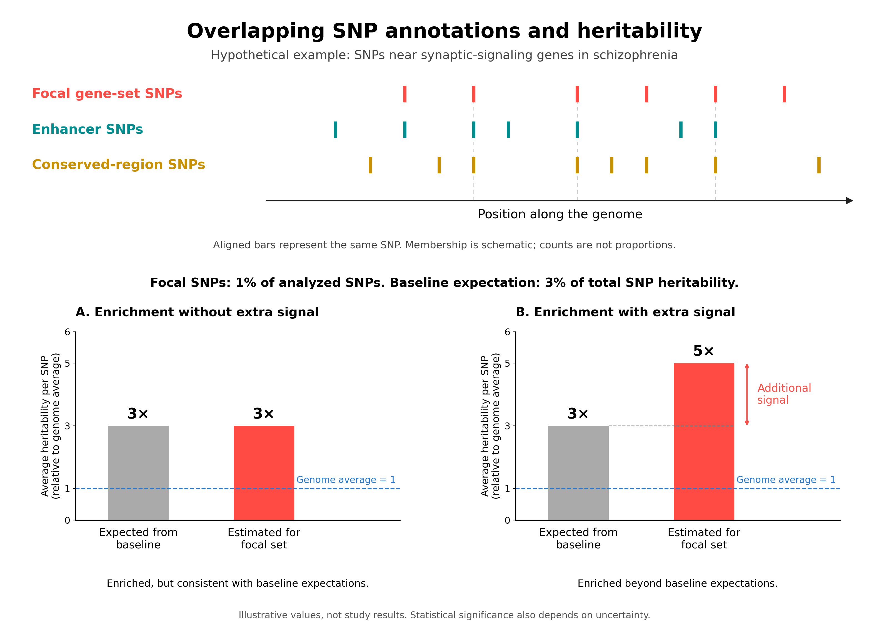

# Partitioning SNP heritability across functional annotations

Last updated on: 2026-11-10

This page explains what partitioned heritability, estimated with stratified LD score regression (S-LDSC; Finucane et al. 2015), computes under the hood, and why the question "How much heritability does my annotation carry?" has two different answers.
For running the analysis, see the [partitioned heritability workflow](../workflows/partitioned-heritability.md) and the [cell-type enrichment workflow](../workflows/cell-type-enrichment.md).
For the exact output columns, see the [partitioned heritability result reference](../../reference/results/partitioned-h2.md).

## Key takeaways

- The model gives each SNP a per-SNP heritability equal to the sum of the coefficients of the annotations it belongs to.
  The total SNP heritability can therefore be decomposed across SNPs and across annotations at the same time.
- **The marginal answer** (`prop_h2`, `enrichment`, `enrichment_p`) counts all the heritability carried by the annotation's SNPs, including what they carry through the other annotations they also belong to.
  `enrichment_p` is a two-sided test of whether the mean per-SNP heritability inside the annotation differs from that outside it.
  A small `enrichment_p` with `enrichment` above 1 means that the annotation's SNPs carry more heritability than their number predicts, whatever the reason, including overlap with other enriched annotations.
  It is typically used to describe how heritability is distributed across general baseline annotations fitted jointly.
- **The conditional answer** (`coefficient`, `coefficient_p`) counts only what membership in the annotation adds while the other annotations are held fixed.
  `coefficient_p` is a one-sided test of whether the coefficient is greater than zero, conditional on the other annotations in the fitted model.
  A small `coefficient_p` means that the annotation carries heritability beyond what those annotations explain; it does not by itself establish a biological mechanism.
  It is typically used for a query annotation tested on top of the baseline annotations, as in cell-type enrichment.

## The model and the two-way decomposition

The partitioned heritability model is

$$
E\left[\chi_j^2\right]
=
N\sum_C \tau_C\,\ell(j,C) + Na + 1,
$$

where $\chi_j^2$ is the association statistic of SNP $j$, $N$ is the sample size, $\ell(j,C)$ is the LD score of SNP $j$ with respect to annotation $C$, $a$ measures confounding, and $\tau_C$ is the coefficient of annotation $C$.
The annotations are fitted jointly in one regression, which estimates one coefficient for each annotation.

The equation follows from a model of the per-SNP heritability, the variance of the standardized effect $\beta_j$ of each reference SNP $j$ [^1]:

$$
h_j^2
=
\operatorname{Var}(\beta_j)
=
\sum_{C:\, j\in C}\tau_C.
$$

In words, a SNP's per-SNP heritability is the sum of the coefficients of the annotations it belongs to.
This page considers binary annotations, in which each SNP either belongs to an annotation or does not [^2].

[^1]: The reference SNPs are the reference-panel SNPs retained for the LD-score calculation, not only the regression SNPs.
    By default, every count on this page ($M_C$, $M_{\mathrm{tot}}$ and $O_{CC'}$) is a common-SNP count (minor allele frequency at least 0.05), so $h^2_g$ is the SNP heritability of the common reference SNPs; see `--count-kind` in the [regression options](../../reference/regression-options.md).

[^2]: Continuous annotations are fitted with the same model, but the summaries `prop_h2` and `enrichment` lose the binary-annotation interpretation described here; see [quantile heritability](../../reference/results/quantile-h2.md) for a summary designed for continuous annotations.

Suppose the model has $K$ annotations $C_1,\dots,C_K$ and a total of $M_{\mathrm{tot}}$ reference SNPs.
For simplicity, write $\tau_k$ for $\tau_{C_k}$ and $M_k$ for the number of reference SNPs in $C_k$.
The table below places each SNP in a row and each annotation in a column.
Each entry is the heritability that the row SNP contributes as a member of the column annotation: the column annotation's coefficient if the SNP belongs to it (annotation value 1), and zero otherwise.

|                       SNP                        | Annotation 1 | Annotation 2 | Annotation 3 | $\cdots$ | Annotation $K$ |            Row sum: per-SNP heritability            |
| :----------------------------------------------: | :----------: | :----------: | :----------: | :------: | :------------: | :--------------------------------------------------: |
|                        1                         |   $\tau_1$   |   $\tau_2$   |     $0$      | $\cdots$ |      $0$       |           $h_1^2=\tau_1+\tau_2+0+\cdots+0$           |
|                        2                         |     $0$      |   $\tau_2$   |   $\tau_3$   | $\cdots$ |      $0$       |           $h_2^2=0+\tau_2+\tau_3+\cdots+0$           |
|                        3                         |   $\tau_1$   |     $0$      |   $\tau_3$   | $\cdots$ |    $\tau_K$    |                       $h_3^2$                        |
|                     $\vdots$                     |   $\vdots$   |   $\vdots$   |   $\vdots$   | $\ddots$ |    $\vdots$    |                       $\vdots$                       |
|               $M_{\mathrm{tot}}$                 |   $\tau_1$   |     $0$      |     $0$      | $\cdots$ |    $\tau_K$    |                $h_{M_{\mathrm{tot}}}^2$                |
| **Column sum: the annotation's own contribution** | $M_1\tau_1$  | $M_2\tau_2$  | $M_3\tau_3$  | $\cdots$ |  $M_K\tau_K$   | $h^2_g=\sum_{k=1}^{K} M_k \tau_k=\sum_{j=1}^{M_{\mathrm{tot}}}h_j^2$ |

**How to read this table:**

- SNP 1 contributes $\tau_1$ as a member of Annotation 1 and $\tau_2$ as a member of Annotation 2.
  A zero entry means that the SNP contributes nothing through that annotation; for example, a non-coding SNP contributes nothing through an annotation of protein-coding regions.
- Within one annotation, every member SNP receives the same coefficient.
  This is the model's assumption.
- A fitted coefficient can be negative, but this does not mean negative heritability.
  A negative $\tau_k$ means that membership in Annotation $k$ lowers the per-SNP heritability relative to SNPs with the same memberships in the other annotations (LDSC-SEG Methods); a member SNP's heritability is its whole row sum, not this one entry.
  A row sum, or the marginal heritability $h^2_g(C)$ defined below, is a variance and cannot truly be negative.
  A negative estimate of one indicates estimation noise or a linear model that fits poorly, because the regression does not constrain row sums to be non-negative.

**The table decomposes the total SNP heritability $h^2_g$ in two directions:**

1. **Across SNPs (rows):** each row sum is the per-SNP heritability $h_j^2$, and summing the rows gives $h^2_g$.
2. **Across annotations (columns):** each column sum $M_k\tau_k$ is the annotation's own contribution, and summing the columns also gives $h^2_g$.

## Two questions about one annotation

The question *"How much heritability does my annotation carry?"* is ambiguous.
Because annotations overlap, it has two different answers, and LDSC reports both.
Take Annotation 2 in the table as the annotation $C$; SNPs 1 and 2 belong to it.

[[Add table color marking here: in one copy, mark the full rows of the member SNPs of Annotation 2 (the marginal question); in the other, mark only the Annotation 2 column (the conditional question).]]

|        SNP         | Annotation 1 | Annotation 2 | Annotation 3 | $\cdots$ | Annotation $K$ |
| :----------------: | :----------: | :----------: | :----------: | :------: | :------------: |
|         1          |   $\tau_1$   |   $\tau_2$   |     $0$      | $\cdots$ |      $0$       |
|         2          |     $0$      |   $\tau_2$   |   $\tau_3$   | $\cdots$ |      $0$       |
|         3          |   $\tau_1$   |     $0$      |   $\tau_3$   | $\cdots$ |    $\tau_K$    |
|      $\vdots$      |   $\vdots$   |   $\vdots$   |   $\vdots$   | $\ddots$ |    $\vdots$    |
| $M_{\mathrm{tot}}$ |   $\tau_1$   |     $0$      |     $0$      | $\cdots$ |    $\tau_K$    |

### Question 1 (marginal): how much heritability do the SNPs in my annotation carry?

The marginal heritability of annotation $C$ is the sum of the per-SNP heritability of its member SNPs, that is, the sum of their **full rows**:

$$
h^2_g(C)
=
\sum_{j\in C} h_j^2
=
\sum_{j\in C}\;\sum_{C':\, j\in C'}\tau_{C'}
=
\sum_{C'} O_{CC'}\,\tau_{C'},
$$

where $O_{CC'}$ is the number of reference SNPs in both $C$ and $C'$, so that $O_{CC}=M_C$ (S-LDSC Online Methods).
This counts every coefficient those SNPs receive, including the coefficients of the other annotations they belong to.
In the example, $h^2_g(C)$ includes the $\tau_1$ that SNP 1 receives from Annotation 1 and the $\tau_3$ that SNP 2 receives from Annotation 3.

S-LDSC defines the enrichment of an annotation as its proportion of heritability divided by its proportion of SNPs:

$$
\text{enrichment}(C)
=
\frac{h^2_g(C)/h^2_g}{M_C/M_{\mathrm{tot}}}
=
\frac{h^2_g(C)/M_C}{h^2_g/M_{\mathrm{tot}}}.
$$

The second form shows that enrichment is the mean per-SNP heritability in the annotation relative to the genome-wide mean.
In `partitioned_h2.tsv`, `prop_h2` is $h^2_g(C)/h^2_g$, `prop_snps` is $M_C/M_{\mathrm{tot}}$, and `enrichment` is their ratio (`Hsq._overlap_output` in `src/ldsc/_regression/estimators.py`).

`enrichment_p` tests whether the mean per-SNP heritability inside $C$ differs from that outside $C$, with the null hypothesis

$$
\frac{h^2_g(C)}{M_C}=\frac{h^2_g-h^2_g(C)}{M_{\mathrm{tot}}-M_C},
$$

which is equivalent to an enrichment of 1.
It is a two-sided $t$ test with `n_blocks` degrees of freedom, computed as in legacy LDSC, so a small value can also mean depletion; read it together with whether `enrichment` is above or below 1.
Its test statistic is a linear contrast of the coefficients that uses their jackknife covariance, not `enrichment_se`, so `enrichment_p` cannot be recomputed from `enrichment` and `enrichment_se`.
It is `NaN` for an annotation that contains every SNP, such as `base`.

### Question 2 (conditional): how much heritability does membership in my annotation add?

The coefficient $\tau_C$ is the change in per-SNP heritability that membership in $C$ adds while the SNP's memberships in all other fitted annotations are held fixed.
Its column sum, $M_C\tau_C$, is the annotation's own contribution to $h^2_g$ and is reported as `category_h2_obs`.
In the example, it is the Annotation 2 **column** only.

When the baseline annotations are fitted together with one query annotation $Q$, a positive $\tau_Q$ means that SNPs in $Q$ have higher per-SNP heritability than SNPs with the same baseline memberships outside $Q$.
This is what "heritability beyond the baseline" means: it is conditional on the measured baseline annotations under the fitted model, not on every feature of the genome.

`coefficient_p` is a one-sided normal test of $\hat\tau_C/\mathrm{SE}(\hat\tau_C)$ against the alternative $\tau_C>0$ (`overlap_aware_category_table` in `src/ldsc/_regression/overlap_model.py`, the same test as `Coefficient_P_value` in the `--h2-cts` output of legacy LDSC).
A negative coefficient therefore gives a p-value near 1.
Correlated annotations can make the distribution of these p-values strongly non-uniform, with many values near 0 or 1 (LDSC-SEG Methods, "Distribution of P values").

### How the two answers are related

Splitting each member SNP's row into the Annotation $C$ entry and the rest splits the marginal heritability into the annotation's own column and everything its SNPs carry through other annotations:

$$
h^2_g(C)
=
\underbrace{M_C\,\tau_C}_{\text{own contribution (conditional)}}
+
\underbrace{\sum_{C'\neq C} O_{CC'}\,\tau_{C'}}_{\text{carried through overlapping annotations}}.
$$

The two answers coincide only when $C$ is disjoint from every other annotation, which almost never happens: the all-ones `base` annotation alone overlaps every annotation.
The second term is why the enrichment of a query annotation is confounded by its overlap with generally enriched baseline annotations.
A query annotation whose SNPs fall in enhancers or conserved regions can be enriched even if membership in the query adds nothing.

### Worked example

The following numbers are hypothetical.

Consider a query annotation $Q$ of SNPs near synaptic-signaling genes, tested for schizophrenia on top of the baseline annotations.
Suppose its SNPs are 1% of the reference SNPs, so `prop_snps` is 0.01, and many of them also lie in enhancers or conserved regions.
Dividing the split above by $h^2_g$ writes `prop_h2` as the own contribution $M_Q\tau_Q/h^2_g$ plus the part carried through the baseline annotations.
Suppose the carried part, computed from the fitted baseline coefficients, is 3%: the baseline annotations alone would give these SNPs 3% of the SNP heritability.

- **If `prop_h2` is 3%**, the enrichment is $0.03/0.01=3$, but the own contribution is $3\%-3\%=0$, so $\tau_Q=0$.
  The query's SNPs carry three times the genome-wide mean per-SNP heritability, but no more than their baseline memberships predict.
  With enough precision, `enrichment_p` would be significant and `coefficient_p` would not.
- **If `prop_h2` is 5%**, the enrichment is $0.05/0.01=5$, and the own contribution is $5\%-3\%=2\%$, so $\tau_Q>0$.
  Knowing that these SNPs lie near synaptic-signaling genes adds information beyond knowing that they lie in enhancers or conserved regions.
  Both tests could be significant.

The baseline coefficients in the carried part are estimated in the same fit as $\tau_Q$, so adding a query annotation can change them.

[[Placeholder figure and example, to be replaced with results from the real-data example analysis suite.
The replacement should show, for one trait and the baseline annotations plus one query annotation: (1) a query annotation that is enriched without a significant positive coefficient, because its heritability is carried through the baseline annotations it overlaps; and (2) a query annotation that is both enriched and has a significant positive coefficient.
For each, report `prop_snps`, `prop_h2`, `enrichment`, `enrichment_p`, `coefficient` and `coefficient_p`, and the split of `prop_h2` into the own contribution and the part carried through the baseline annotations.
The current figure labels the query annotation "Focal gene-set SNPs"; the replacement should say "query annotation".]]

*Placeholder illustration with hypothetical values.*

### A note on the word "enrichment"

The literature uses "enrichment" for both questions.
S-LDSC reports marginal enrichment for its baseline annotations (Figure 4), but labels its cell-type results, which rank annotations by the coefficient p-value, "Enrichment of individual cell types" (Table 1) and "Enrichment of cell type groups" (Figure 6).
The name of the cell-type enrichment analysis follows the second usage.
On this page and in the package's columns, "enrichment" means only the marginal ratio in the `enrichment` column; the conditional quantity is called the coefficient.

## Choosing and reading the tests

Choose the test that matches your question:

- **General functional annotations fitted jointly** (the functional-category regime: baseline annotations only), such as coding regions, enhancers and conserved regions: read `enrichment` and `enrichment_p`.
  S-LDSC Figure 4, the enrichment of 24 main baseline annotations averaged over nine traits, is an example.
- **A query annotation tested on top of the baseline annotations** (the cell-type-specific regime: baseline annotations plus one query annotation per model), such as the specifically expressed genes of a cell type: read `coefficient` and `coefficient_p`.
  This is the test used by S-LDSC for its cell-type annotations and by LDSC-SEG (Finucane et al. 2018).
  For gene-list query annotations, LDSC-SEG also conditioned on an annotation of all genes, so that the query is compared with genes in general; see the [optional control gene list](../workflows/gene-list-ld-scores.md#optional-control-gene-list).

The package names the regime and the column to focus on in the log, and in the cell-type-specific regime it sorts `partitioned_h2.tsv` by `coefficient_p` (`src/ldsc/_regression/partitioned.py`).
Choose the test before looking at the results, and use the same test for every trait and annotation in one multiple-testing family; switching tests to obtain significance answers a different question than the one you asked.

For one query annotation fitted with the baseline annotations, the two tests can combine in four ways.
"Enriched" below means a small `enrichment_p` with `enrichment` above 1.

| | `coefficient_p` significant | `coefficient_p` not significant |
| --- | --- | --- |
| **Enriched** | Enriched, and carries heritability beyond the baseline annotations. | Enriched, but the overlapping baseline annotations can explain the enrichment. |
| **Not enriched** | Carries heritability beyond the baseline annotations without detectable enrichment; see the last caution below. | Neither test detects a difference. |

Cautions:

- A non-significant test is not evidence of absence.
  An annotation can carry heritability that the data are not precise enough to detect, especially when the annotation is small or the GWAS has a small sample size.
- A significant positive coefficient does not by itself establish a specific biological mechanism; an unmeasured feature that overlaps the annotation can produce the same result.
- A significant coefficient without significant enrichment is not a contradiction.
  Suppose a baseline annotation $B$ covers 80% of the SNPs, a query annotation $Q$ disjoint from $B$ covers 10%, and the per-SNP heritability is proportional to $1+9\,\mathbf{1}\{j\in B\}+\mathbf{1}\{j\in Q\}$.
  The coefficient of $Q$ is positive, but SNPs in $Q$ have mean per-SNP heritability 2 against a genome-wide mean of $0.8\times 10+0.1\times 2+0.1\times 1=8.3$, so the enrichment of $Q$ is $2/8.3\approx 0.24$.
  Membership in $Q$ raises per-SNP heritability relative to comparable SNPs outside $B$, even though $Q$'s SNPs carry less heritability than the average SNP.
