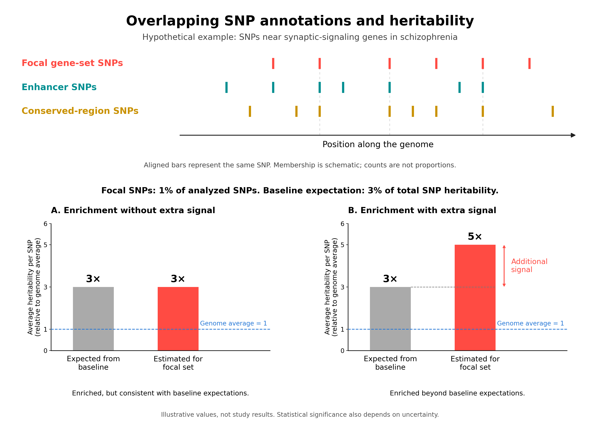

# Partitioning SNP heritability across functional annotations

Last updated on: 2026-10-27

TLDR (more approachable, all takeaways):

- two-way decomposition
- enrichment is about ..., coefficient is about ...
- which one should I use
- how to interpret the output
- 

FAQ, interpretation, 

--- details ---

In this tutorial, we'll walk you through what happens under the hood of partitioned heritability and distinguish its different use cases.

## The two-way decomposition

The partitioned heritability model is
$$
E\left[\chi_j^2\right]
=
N\sum_C \tau_C \ell(j,C) + Na + 1.
$$
Essentially, this model attributes the total SNP heritability of the trait to all SNPs across the genome [^1].

[^1]: Specifically, all reference SNPs included in the LD-score calculation.

$$
\operatorname{Var}(\beta_j)
=
\sum_{c=1}^{K}\tau_c\,\mathbf{1}\{j\in C_c\}
=
\underbrace{\tau_1\,\mathbf{1}\{j\in C_1\}}_{\text{contribution of annotation 1}}
+\cdots+
\underbrace{\tau_K\,\mathbf{1}\{j\in C_K\}}_{\text{contribution of annotation }K}.
$$

Dividing both sides by the total SNP heritability reveals the contribution of each annotation for each SNP $j$.

This equation says that the SNP heritability attributable to SNP $j$ is a sum of the contributions from all the annotations to which SNP $j$ belongs.

The following table provides a more intuitive illustration.
Partitioned heritability is a two-way decomposition.
We decompose heritability both *across SNPs* (rows) and *across functional annotations* (columns).

|   SNP    | Annotation 1 | Annotation 2 | Annotation 3 | $\cdots$ | Annotation $K$ |
| :------: | :----------: | :----------: | :----------: | :------: | :------------: |
|    1     |   $\tau_1$   |   $\tau_2$   |     $0$      | $\cdots$ |      $0$       |
|    2     |     $0$      |   $\tau_2$   |   $\tau_3$   | $\cdots$ |      $0$       |
|    3     |   $\tau_1$   |     $0$      |   $\tau_3$   | $\cdots$ |    $\tau_K$    |
| $\vdots$ |   $\vdots$   |   $\vdots$   |   $\vdots$   | $\ddots$ |    $\vdots$    |
|   $p$    |   $\tau_1$   |     $0$      |     $0$      | $\cdots$ |    $\tau_K$    |

How to read this table:

- Each entry is the contribution to heritability from the row SNP as a member of the column annotation.
  Hence, this table decomposes the total $h^2_g$ of the trait into the contribution from each (SNP, annotation) pair.
  For example, SNP 1 contributes $\tau_1$ to the total $h^2_g$ as a member of Annotation 1 and $\tau_2$ as a member of Annotation 2.
- A zero entry means the SNP does not belong to that annotation, and therefore does not contribute heritability through that annotation.
  For example, a SNP in a non-coding region does not contribute heritability through a functional annotation representing protein-coding regions (because it does not lie in that region).
- Within the same annotation, all member SNPs contribute equally (this is the model assumption).
  For example, for Annotation 1, all SNPs except SNP 2 share the same heritability contribution $\tau_1$.
- The sum over all entries in this table is the total SNP heritability of the trait:

$$
\text{total }h^2_g \text{ of the trait} = \sum_{\text{all SNPs}} \sum_{\text{all annotations}} \text{per-SNP heritability within that annotation}.
$$

We can view this decomposition from two perspectives:

1. **Decomposing total $h^2_g$ by SNPs:** The per-SNP heritability is the row sum, i.e., the sum of its portions in the annotations it belongs to.
   For example, the per-SNP $h^2_g$ for SNP 1 is $\tau_1 + \tau_2$, and that for SNP 2 is $\tau_2 + \tau_3$.
   Thus, summing the per-SNP heritability across all SNPs yields the total SNP heritability of the trait.
2. **Decomposing total $h^2_g$ by annotations:** The heritability from annotation $j$ is the column sum, i.e., the sum of the within-annotation contributions of its member SNPs.
   For example, the $h^2_g$ from Annotation 1 is $M_1 \tau_1$, where $M_1$ is the number of reference SNPs in Annotation 1. [^2]

[^2]: **Caveat:** This differs from the per-annotation $h^2$ in the stratified LD score regression (S-LDSC; Finucane et al. 2015) paper, which is denoted by $h^2(C_c)$. That quantity is marginal and includes contributions from overlapping annotations, summing the *entire row sums* for its member SNPs: $h^2(C_c)=\sum_{j\in C_c}h_j^2$. They coincide only when the annotations are disjoint (i.e. each SNP belongs to exactly one annotation). This almost never happens. [[TODO: consider remove this since it adds confusion rather than resolve it.]]

|                       SNP                        | Annotation 1 | Annotation 2 | Annotation 3 | $\cdots$ | Annotation $K$ |                 Row sum: per-SNP $h^2_g$                  |
| :----------------------------------------------: | :----------: | :----------: | :----------: | :------: | :------------: | :-------------------------------------------------------: |
|                        1                         |   $\tau_1$   |   $\tau_2$   |     $0$      | $\cdots$ |      $0$       |             $h_1^2=\tau_1+\tau_2+0+\cdots+0$              |
|                        2                         |     $0$      |   $\tau_2$   |   $\tau_3$   | $\cdots$ |      $0$       |             $h_2^2=0+\tau_2+\tau_3+\cdots+0$              |
|                        3                         |   $\tau_1$   |     $0$      |   $\tau_3$   | $\cdots$ |    $\tau_K$    |                          $h_3^2$                          |
|                     $\vdots$                     |   $\vdots$   |   $\vdots$   |   $\vdots$   | $\ddots$ |    $\vdots$    |                         $\vdots$                          |
|                       $p$                        |   $\tau_1$   |     $0$      |     $0$      | $\cdots$ |    $\tau_K$    |                          $h_p^2$                          |
| **Column sum: annotation contribution to $h^2_g$** | $M_1\tau_1$  | $M_2\tau_2$  | $M_3\tau_3$  | $\cdots$ |  $M_K\tau_K$   | total $h^2_g=\sum_{c=1}^C M_c \tau_c=\sum_{j=1}^{p}h_j^2$ |

---------- draft ------------------

## Distinguishing the "marginal" and "conditional" contribution of an annotation

This is a common pitfall that one can easily encounter when trying to answer the question "How much heritability does an annotation contribute?".
This is a vague question, and we'd like to clarify it here to guide a rigorous practice of the package.
This question is essentially two questions.

Question 1: How much heritability do the SNPs included in my annotation carry?

This is a marginal question

[[Add table color marking here.]]

example figures from previous papers. interpretation. one-sided or two-sided interpretation.

<u>S-LDSC paper (Finucane et al. 2015): figure 4</u>

The model provides both `coefficient_p` and `enrichment_p`. Which should I use? 

one-sided test

enrichment

The S-LDSC paper introduces this notion "enrichment"

different benchmark baseline

----------- draft ------------

**Enrichment relative to the genome-wide average: `enrichment_p`**

**Conditional, or additional, enrichment: `coefficient_p`**

## Enrichment p-value or coefficient p-value?

This depends on the scientific question you ask.
In short, enrichment asks *where* genetic signal is concentrated.
The coefficient test asks whether SNPs near these genes carry *additional trait-related signal beyond their general genomic features*.

Suppose we want to test whether a gene set is “enriched.”
As we will see, this term can refer to different scientific questions.

**The enrichment question is: “Do SNPs near these genes carry more of the trait’s heritability than we would expect from their number?”**
Recall that enrichment is the proportion of heritability divided by the proportion of SNPs.
An enrichment greater than 1 therefore means that these SNPs carry more per-SNP heritability than the genome-wide average.
The comparison is with the share of heritability the gene set would receive if the SNP heritability were distributed equally across all SNPs in the genome.

Biologically, enhancers, coding regions, and conserved DNA can carry more per-SNP heritability than the genome-wide average, and <u>this pattern is not necessarily unique to the trait we are studying.</u>
A gene set can therefore be enriched because many of its SNPs lie in these functional regions, even if its biological grouping provides no additional information beyond those genomic features.

**The coefficient question is more specific: “Does this gene set have an *additional* connection to the trait beyond what we would expect from those genomic features?”**
It tests whether the SNPs in this gene set help identify additional genetic signal after accounting for the baseline annotations.
(We therefore include the 53 baseline annotations as covariates in the regression.)
A significant positive coefficient indicates that the gene set captures some of the trait’s heritability that is not fully accounted for by the baseline annotations.
Thus, it gives us stronger evidence that the biological process or function represented by the gene set is relevant to the trait, beyond the fact that its SNPs lie in generally important functional regions.
In this sense, the coefficient test asks more of the gene set than the enrichment test does.

**Takeaway:** In practice, enrichment tests are often used to examine how heritability is distributed across *general* functional annotations, whereas coefficient tests are often used to assess whether a *query* gene set shows significant trait-related signal beyond what is explained by the baseline annotations.
For a query gene set, “enrichment” often refers informally to the latter additional signal.
A rule of thumb is:

- If you are examining how heritability is distributed across common, general functional annotations (e.g., enhancers, conserved regions, coding regions, etc.) by including them together in the regression, you probably want the enrichment test.
- If you are testing query gene sets one at a time, i.e., fitting each alongside the baseline annotations to assess whether it carries additional trait-related signal, the coefficient test usually matches your question.
  A common application is to test marker gene sets for different cell types to identify which cell types show additional trait-related signal ("enriched heritability").

**Numerical example:**

[[I constructed a numerical example and used ChatGPT to fill in the illustrative values and SNP sets.]]

Consider a query gene set of synaptic-signaling genes in schizophrenia.
The following numbers are hypothetical.

Suppose SNPs near these genes represent **1% of the SNPs analyzed**, and many also lie in enhancers or conserved DNA.
These are overlapping labels on the *same* SNPs: a SNP can belong to the query gene set, the enhancer annotation, and the conserved-region annotation simultaneously.
(The functional annotations also contain many SNPs outside the query gene set.)
This overlap matters because SNPs in enhancers and conserved regions tend to carry more per-SNP heritability than the genome-wide average.
Suppose that the baseline model alone predicts that they would account for **3% of total SNP heritability** because of their membership in these functional annotations.

- **If this gene set accounts for 3% of total SNP heritability**, it is 3x enriched relative to the genome-wide average.
  However, its signal matches what we would expect from the functional regions it contains (also 3% as assumed above).
  We could therefore see significant enrichment without a significant coefficient.

- **If this gene set accounts for 5% of total SNP heritability**, its SNPs carry more schizophrenia-related signal than the 3% predicted from their baseline annotations.
  Knowing that these SNPs lie near synaptic-signaling genes therefore adds information beyond knowing that they lie in enhancers or conserved regions.
  Both enrichment and the positive coefficient could be significant.

A significant positive coefficient therefore supports the disease relevance of this synaptic-signaling gene set, beyond what is captured by the common, general baseline genomic features.

*Figure generated by ChatGPT.*

baseline annotations are "control covariates"

cannot distinguish whether the query gene set actually incorporates trait-specific biological signals or just reflects SNP overlap with the baseline annotations.
Our regression (enrichment, in particular) cannot distinguish the gene-set-specific contribution within the baseline regions (the overlap conflates it) from the intrinsic SNP heritability contribution of the baseline annotations themselves. 

53 baseline + **1 query**

1. no enrichment, no coefficient: query gene set not enriched at all (not carrying SNP heritability for the trait).
2. enrichment but no coefficient: query gene set carries significantly high SNP heritability for the trait, but this heritability acts mainly through general common (baseline) features (e.g., enhancers)
3. enrichment with coefficient: query gene set carries SNP heritability for the trait and encodes specific biological pathways / identities for the trait (pathology), beyond the general genomic features
4. coefficient but no enrichment: rare. lack proper interpretation (for now).

